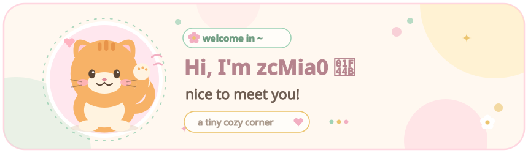
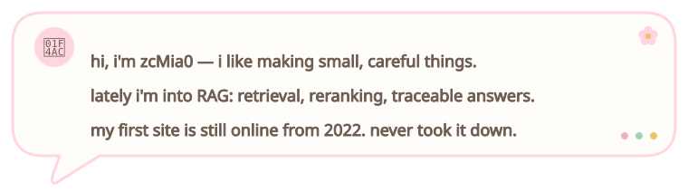
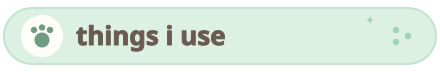

<!-- ============================================================
     🌸 zcMia0 · GitHub profile README · 软萌日系 Q 版治愈风

     调色：奶油白 #FFF8F0 / 淡粉 #FFD6E0 / 薄荷绿 #C8E6D4 / 鹅黄 #FFE9A8
     全部资产在 ./assets/ ，为自包含静态 SVG（无 GIF、无打字机动画、无外链字体）。

     ── 内容已按真实资料填好，不再是占位符 ──────────────────────
     数据源：github.com/zcMia0 的公开 API 与仓库文件（采集于 2026-11-04）。
     界面文案集中在 profile.json，改完执行 python build.py 即可重建
     README.md、assets/*.svg 与 preview.html。逐条依据见 PROFILE_INFO.md。

     ── 想换主角？────────────────────────────────────────────
     1) 橘猫 ↔ 柴犬：python build.py --shiba / --cat
     2) 换成自己生成的图：python build.py --mascot assets/mascot.png
        （图片会被内嵌成 data URI，GitHub 上照样显示，无需外链）
     3) 改「关于我」三句话：编辑 profile.json 的 about_lines

     ── 统计卡片 ──────────────────────────────────────────────
     3 张卡片按 username=zcMia0 生成，用 bg_color=FFF8F0 等参数
     调成奶油色（不是默认紫），关掉动画、加了 24px 圆角。
     公共实例偶尔限流；若加载不出来可自托管。

     ── 分隔线：assets/divider.svg 是圆头虚线，未使用 Markdown 水平线 ─
     ============================================================ -->

  

<!-- ① 关于我 · 聊天气泡 -->

<!-- ② 我在用的东西 · 两列 · 圆圆小图标 + 文字（不用徽章墙） -->

<table align="center" width="100%" cellpadding="10">
  <tr>
    <td align="center" width="50%">
      
<b>🐾 &nbsp; languages</b>

      

         &nbsp; Python 
         &nbsp; TypeScript 
         &nbsp; HTML + CSS 
         &nbsp; Vue
      

    </td>
    <td align="center" width="50%">
      
<b>🧸 &nbsp; tools</b>

      

         &nbsp; Git + GitHub 
         &nbsp; Docker 
         &nbsp; FAISS · BM25 
         &nbsp; FastAPI · Vue
      

    </td>
  </tr>
</table>

<!-- ③ 我做过的小东西 -->

  🟧 &nbsp; <a href="https://github.com/zcMia0/enterprise-rag-workbench"><b>enterprise-rag-workbench</b></a> &nbsp;—&nbsp; 企业知识库 RAG 工作台：文档入库 → 带溯源的流式问答 
  🟩 &nbsp; <a href="https://github.com/zcMia0/three-stage-rag-kit"><b>three-stage-rag-kit</b></a> &nbsp;—&nbsp; 电商三级检索：BM25 粗召回 → 向量语义 → 交叉编码器精排 
  🟨 &nbsp; <a href="https://zcMia0.github.io"><b>zcMia0.github.io</b></a> &nbsp;—&nbsp; 用 Hexo 搭的小小个人站点，从 2022 年挂到现在 
  🟪 &nbsp; <a href="https://github.com/zcMia0?tab=repositories"><b>a few handy forks</b></a> &nbsp;—&nbsp; fuzz 字典、逆向工具、agent 框架，fork 来当工具箱用

<!-- ④ 现在在干嘛 -->

🍡 &nbsp; currently eating <b>something sweet</b> &nbsp;·&nbsp; learning <b>retrieval + reranking</b> &nbsp;·&nbsp; building <b>enterprise-rag-workbench</b>

<!-- ⑤ 奶油色统计卡片（可选小尾巴，删掉这一整段也不影响结构） -->

tiny numbers, big feelings

<table align="center" cellpadding="6">
  <tr>
    <td align="center"></td>
    <td align="center"></td>
    <td align="center"></td>
  </tr>
</table>

<!-- ⑥ 底部 -->

  
  &nbsp;&nbsp;
  

thanks for stopping by 💛

